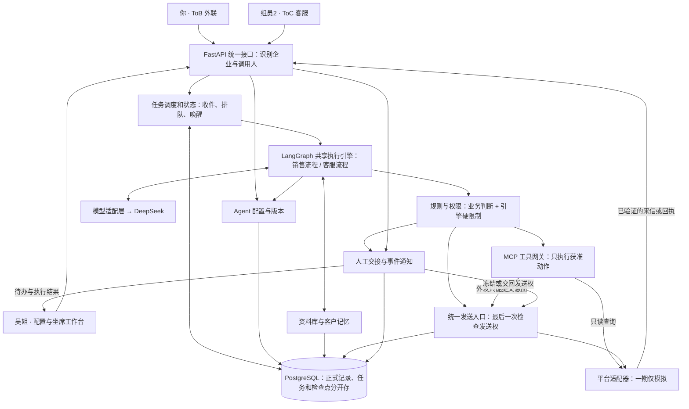

# ChatMoney 共享 Agent 引擎开发方案与 API 接口规范 V1.0

**评审稿｜核查日期：2026-11-13｜读者：ToB 外联负责人、客服负责人、吴姐。** 本文中的接口、返回值、用例均为拟定契约，所有编号及客户消息均为模拟数据，未部署、未实测。API 指业务程序之间约定好的调用入口。

日常处理来信时，你和组员2只需做三件事：选择已发布的 Agent（按配置处理任务的助手），告诉引擎“正在和谁谈”，把客户这句话交进去。引擎自己找资料、读这位客户的记忆、运行这一轮并记录结果。**提交一句话、生成一个答案、平台确认发出，是三件不同的事。** 工作台要分别显示，不能把“任务受理”当成“已回复客户”。

**评审时先走一遍**：用第 6 节的两段调用分别提交“我想要正式报价”和“我的订单发货了吗”。前者应冻结自动发送、通知吴姐；后者只在核实用户与订单关系后查询模拟订单。再用第 8 节检查：重复提交、断线或换一个企业身份，结果还能不能信。

## 1. 工程里现在有什么

下表是原设计评审时的工程盘点。当前实现与测试记录见本仓库的修复报告。

**依据**：吴姐的业务蓝图（内部设计原件）、配套技术设计（内部设计原件）均为 v0.1；对照了个人路线 V1.0、精简基线 V1.1、开源项目调研报告、技术选型、架构图和实施清单。

| 能力 | 当前是否有代码 | 是否验证可用 | 后续处理 |
|---|---|---|---|
| 模型文本、多轮、流式、工具与结构化输出 | 无项目代码 | 仅核实供应商文档；未用账号调用 | 接入适配层，再用测试账号验收 |
| 企业、产品、角色版本及资料库 | 仅设计 | 否 | 对齐资料归属、批准人和可见范围 |
| 客户记忆、独立会话、流程恢复 | 仅设计 | 否 | 先做跨企业、跨客户和重启用例 |
| 工具网关、渠道与发送控制 | 仅设计 | 否；真实账号权限未知 | 先模拟查询、模拟发送和回执 |
| 任务、待机、暂停、人工交接 | 仅设计 | 否 | 先确定谁有发送权，再写调度 |
| 统一接口、事件与审计 | 仅设计 | 否 | 由两个业务调用方共同审查本契约 |
| 外部 Flutter 客户端、趋势系统、真实渠道 | 本项目未见；外部代码未知 | 无法验证 | 由实际维护人给接口和测试条件 |

**结论**：已实现并验证的引擎能力为 0；本地也没有“已有代码但未验证”的引擎模块。能复用的是业务规则、研究结果与架构设计。下文“建议”是开发方案，“待确认”是需要团队作决定的地方。

## 2. 引擎管什么，业务方管什么

| 谁 | 要交付的能力或规则 | 不应交给它做的决定 |
|---|---|---|
| 共享引擎（维护人待定） | 模型适配、版本读取、检索、记忆、流程执行、工具授权、任务控制、统一外发、人工与审计 | 不判断什么行业最适合产品，也不决定能给多少折扣 |
| 你：ToB（面向企业的销售） | 制定目标客户条件、找线索、按产品算匹配分；根据原话算意向分；提供跟进间隔、身份/正式报价等交接规则 | 不直接读引擎数据库，不持有渠道发送凭据 |
| 组员2：ToC（面向消费者的客服及内容） | 提供客服政策、订单归属验证、查询和退款分流规则；内容发布仍走本业务审核 | 不复写模型或记忆系统；查物流不等于有权退款 |
| 吴姐、组员1 | 吴姐批准产品事实、可对外承诺范围及交接条件；组员1提供需求分析和获准使用的数据 | 不把需求单或客户自述当成已批准的产品事实 |

蓝图的“概率 ≥70%”与配套设计的“先定标签再定阈值”仍需吴姐统一。**初期无可靠成交概率，返回未知；匹配分、意向分、证据覆盖率都不能代替概率。** 正式报价、客户要求真人等可独立触发交接。引擎只理解“请求人工”和依据，不内置任何销售百分比。客服同样可用这个动作处理投诉。两类业务都不能通过配置放宽租户隔离或绕过停发。

## 3. 一条来信怎样走过系统



例如“20 个账号怎么报价”：后端先保存来信并给调用方一个执行编号；后台进程（Worker）再读取已发布角色、A1 产品资料和当前客户记忆。LangGraph（按步骤组织执行的 Python 框架）安排 DeepSeek 大模型理解来信，业务规则判定“正式报价需人工”。引擎在数据库里先冻结这段对话的自动发送权，再登记工单和通知事件；调用方查到的是“需要人工”和原话，客户不会收到模型拟的报价。

引擎对外是**独立服务**，对内可先是一套 Python 应用加后台进程。销售和客服使用不同流程入口、独立待办队列，共用模型客户端和发送控制；客户等三天不占进程。部署设计沿用 Docker Compose（在一台机器描述和启动所需服务），不要求前端更换，也不拆一组微服务。

## 4. 八个核心模块：谁提供输入，谁对结果负责

### 4.1 模型适配层：业务只说想得到什么

**输入 → 输出**：流程提供已批准的指令、按顺序的历史消息、本轮问题、允许展示的工具说明和生成设置。适配层负责把它们翻译成供应商格式。文本、结构化提取、工具提议是不同输出；不把工具提议视为执行成功。

| 引擎内部输入（不对公网开放） | 引擎内部输出 |
|---|---|
| `profile_model`（内部模型别名）、`instructions`、`history[]`、`current_message` | `text` 或 `object`，无内容为 null；工具建议为 `tool_calls[{id,name,args}]` |
| `mode=text/json/tools`、`schema_ref?`、`tools[]`、`stream`、`params{max_tokens,...}`、`run_id` | `finish_reason`、`provider_request_id`（供应商回复 id）、`actual_model`、`usage{input_tokens,output_tokens,total_tokens}`、`attempt`；不明用 null |

**官方核验，未实调**：截至 2026-11-13，[官方模型表](https://api-docs.deepseek.com/quick_start/pricing/)列出的调用标识是 `deepseek-flash`，当日对应 DeepSeek-V4.1-Flash-1017。选用 [Chat Completions](https://api-docs.deepseek.com/api/create-chat-completion/)：`POST https://api.deepseek.com/chat/completions`，由服务端使用 Bearer 密钥，发送 `model`、`messages`。多轮由引擎重组最近消息，而非假定模型记得昨天的客户。发布前重核模型可用性，不让业务方写死供应商标识。

- 普通生成取 `choices[0].message.content`；[JSON 输出](https://api-docs.deepseek.com/guides/json_mode/)传 `response_format={"type":"json_object"}`，指令说明 JSON 格式并给样例。Pydantic 再核对字段、类型、证据编号；空白、截断、缺字段不能成为客户事实。
- [工具调用](https://api-docs.deepseek.com/guides/tool_calls/)传 `tools`；等参数完整再校验。把助手的原始提议和带相同 `tool_call_id` 的工具结果一并传回模型。V1 建议显式关闭思考模式、分开“抽取/选工具”与“起草”；不依赖测试版严格模式。
- 流式用 `stream=true` 接收增量片段，以最终结束原因和用量结算。仅在获准的内部预览使用草稿流；**断流不产生可发消息**，也不把未审核的片段推给客户。Token 是模型计量文字的单位，按企业、任务、轮次和调用尝试登记；供应商未回报的用量标未知，不能算零。
- 一期设连接/总超时、每轮预算、最大工具轮数。超时、限流或服务暂时异常在预算内退避有限次；参数和鉴权错误不重试。提取仍无效则保留原话并请求人工。未来换供应商只换适配器，并回放同一批测试对话。

### 4.2 配置管理：吴姐发布一个角色，许多客户都能使用

用 Pydantic（字段和类型检查器）验证草稿，PostgreSQL（关系数据库）保存每次发布的快照。**输入**是角色名称、用途、人设/语气、目标、工作流、可说/不可承诺清单、企业和产品资料版本、获准的工具、资料库快照、业务策略版本及接管条件；**输出**是 `agent_id + version`。调用方只传引用，不把企业资料拼进每次消息。`policy_ref` 指向销售或客服规则集及其版本，`handoff_on` 只能选该规则集支持的触发项。

一期支持新建、改草稿、校验、发布、停用。发布须检查所有引用同企业、同适用产品、资料已批准、工具已登记、业务规则已部署。改已发布角色时创建新草稿；已开任务继续引用旧版本。停用阻止新任务并阻断已有自动执行，历史仍可查；后来创建的新版本也不自动复活旧任务。紧急撤回资料或渠道权限对旧任务也立即生效。后续再做灰度发布和显式版本迁移。

### 4.3 资料库与记忆：让引擎知道“这句话来自哪里”

| 信息 | 写入来源 → 读者 | 一期保存和读取规则 |
|---|---|---|
| 企业/产品知识 | 吴姐上传、审核 → 同企业获准角色 | 原件、修订号、段落、允许对外说的事实和批准人；按已发布快照检索 |
| 客户资料 | 获准业务记录、客户原话 → 对应客户的授权流程 | 职位、预算等带来源和适用产品；缺项为未知，不能从别的客户补 |
| 对话记忆 | 已保存的消息 → 当前客户会话 | 原话保留；最新摘要、待办和重要事实引用消息编号。人工纠正留旧值、操作者和依据 |
| 工作流状态 | LangGraph 节点 → 下次运行 | 检查点只存步骤、编号和必要的中间结果；不是聊天档案，也不是产品知识库 |

**从上传到回答**：一期接收 UTF-8 的 TXT、Markdown；限制大小、识别实际格式、拒绝不可解析文件。按标题和段落切分，给每段稳定编号。新上传默认未批准；批准指定文档集合才形成新快照。每次回答先限定企业、产品、快照和允许对外使用的范围，再用标题、产品编号、人工关键词和短语匹配取少数片段；资料不足时说明未知或交人，资料中的指令一律当普通文本。

这种“先找证据再生成”叫 RAG（检索增强生成）。一期用 PostgreSQL 即可；中文样例先实测专有名词、同义词与型号，不能假设默认全文分词就能搜好中文。若有代表性问题经常召回不到，再比较合适的中文分词与 pgvector（数据库里的向量检索扩展）；语义向量需要另选授权的多语言嵌入模型并记录名称、版本及重建策略，本期不引入嵌入模型，也不假定 DeepSeek 有此接口。

**下一轮怎样接着谈**：先读当前会话最新原话，再取带出处的摘要、该产品已确认的事实和相关知识。人工纠正优先于旧摘要；撤回的资料不再喂给模型。摘要错了可从原文重建。跨客户不共享摘要；跨企业的查询、缓存和引用都必须按认证身份隔离。将来才考虑在取得权限后跨同一客户的会话复用已确认事实。

### 4.4 执行引擎：每次只推进当前客户的一轮

LangGraph 把读配置、取证据、分析、申请工具、业务判断、起草、交接和保存连接成可分支的流程。**输入**是持久化的来信或到期事件；**输出**是草稿、获准发送意图、人工待办或等待状态，以及可查询的执行记录。选择节点由程序控制；模型只给建议。检查点（Checkpointer）保存“走到哪一步”，不是付款、发送等动作的凭证。

| 名称 | 举例及关系 |
|---|---|
| AgentProfile（角色模板） | “甲企业 A1 销售顾问 v1”，可服务许多客户 |
| SalesTask（销售业务任务） / 引擎 Task | “推广 A1”可对应一个引擎调度任务并绑定角色版本。客服没有销售任务，可由引擎为一段客服会话创建接待任务 |
| Customer / AgentSession（客户 / 独立会话状态） | 同一个角色服务客户甲、乙，分别保存进度。一个客户谈不同产品，是不同任务和商机，不混合记忆 |
| Conversation（渠道上的实际对话） | 由企业、渠道账号和平台对话编号定位；这里保存整段对话的发送权。多条业务任务不能在同一对话上同时自动回复 |
| Run（一次执行） | 一条来信或一次定时唤醒产生一轮；一次运行完成不等于整场会话结束 |

一期用共享 Worker、数据库检查点和唯一的 `thread_id`（由引擎按企业、会话生成的恢复编号）。同一会话轮次顺序执行；不同客户可并发。恢复读取原线程；节点可能被再次进入，所以外部动作必须查执行账本，不因重放再发一次。[持久执行](https://docs.langchain.com/oss/python/langgraph/durable-execution)与[人工中断/恢复](https://docs.langchain.com/oss/python/langgraph/interrupts)是框架能力，发送权限仍由后端掌管。后续可增加流程类型，无需改业务调用方式。

### 4.5 工具与渠道：能看见工具，不代表有权执行

MCP（模型上下文协议）让客户端用相同方式发现、调用工具；MCP Server 是提供工具的一端。[官方 Python SDK](https://github.com/modelcontextprotocol/python-sdk)负责协议传输。平台官方 API 决定账号实际上能做的事；渠道 Adapter（适配器）负责验签、账号授权、消息格式、发送窗口、回执和查询。**MCP 不代替任一项授权。**

| 步骤 | 输入 → 输出 | 一期规则 |
|---|---|---|
| 注册与发现 | 维护人登记受信服务、工具名、参数格式、读写等级、所需权限 → 允许展示的工具目录 | 用 `tools/list` 检查与本地批准版本一致；目录按租户、角色、账号过滤。客户端不能传任意服务器地址；签名变化先禁用再审核 |
| 提议与执行 | 模型给工具名、参数、调用编号 → 网关检查后用 `tools/call` 调用 | Pydantic 验参数；引擎从可信记录补账号及客户范围。订单归属必须由客服业务验证，不能只凭客户给出的订单号 |
| 接收结果 | 模拟订单、客户资料、错误或发送意图 → 统一 `{execution_id,status,data,error}` | 校验结果结构、裁剪敏感字段；失败回传可解释原因。外部文本不作为指令。记录工具版本、参数摘要、耗时、操作者和执行编号 |
| 发送与收信 | 已批准的发送意图 → 模拟渠道回执；模拟渠道来信 → 已验来源的入站消息 | 只读超时可有限重试。写操作用固定业务键；受理不明先核对。所有外发工具只能提交给统一发送入口，不能自行调用平台发送 |

一期只登记模拟的 `order.lookup` 和 `channel.reply`，可另用模拟企业目录验证 ToB 查询。后来才考虑邮件、微信、LINE、Amazon 或抖音；按实际账号和官方能力审核，能查到企业不等于能主动联系。只允许查询的账号应只能出草稿。工具目录内部维护，不向业务方暴露“任意执行工具”的公共接口。

### 4.6 规则与权限：业务决定应该做什么，引擎决定是否可以执行

| 检查位置 | 谁写规则 | 输入 → 输出与拒绝示例 |
|---|---|---|
| 调用前 | 引擎 | 认证身份、企业、资源归属、角色版本、工具白名单、实际账号权限 → 放行或拒绝；知道另一企业的编号也查不到 |
| 业务判断 | ToB / 客服各自维护 | 已验证事实、证据编号、当前动作、版本化策略 → `allow / draft_only / handoff / deny`、原因码、证据引用；例：正式报价交吴姐，订单归属不明不查 |
| 发送前 | 引擎统一入口 | 渠道、目的、联系资格、退订、窗口、频率、任务状态、人工归属、发送代次 → 排队、只留草稿或拒绝 |
| 交给平台前 | 同一发送入口 | 锁住实际渠道对话，再查上述条件和代次；核对当前任务是唯一自动发言方。条件改变即作废旧意图 |

一期用 Python 的已登记规则函数和 Pydantic 配置，不让业务上传可执行脚本。业务接入契约建议为 `evaluate(policy_ref, phase, facts, action, evidence_refs) → {decision,reason,evidence_refs,next_due_at?}`；一期为进程内受审查的模块，不需网络回调。每个流程选择自己的规则集；业务规则不可扩大公共权限。无规则版本、返回无法解析或判断超时，均不外发。

退订/撤权优先停联并取消相应跟进；如还要通知人工，可发内部待办，不能继续联系。正面意向不能跳过上述检查。人工能处理正式报价，不代表可以越过退订或平台权限。所有渠道凭据只交给适配器。租户内也限制坐席、业务线、客户和用途；日志脱敏，知识、消息及备份保留期由吴姐确认。后续再考虑规则编辑器。

### 4.7 状态与调度：等待不占进程，暂停不是删除

| 对象 | 一期状态与转换 | 重新开始的条件 |
|---|---|---|
| 角色 | `draft → published → disabled`；发布后仍可另开草稿，`draft_revision` 与已发布 `version` 分开 | 已停用角色不能执行；读取历史不受影响 |
| 调度任务 | `pending → running ⇄ waiting`；活动任务可 `paused → running`；达成目标 `completed`，主动停止 `cancelled`，无法恢复 `failed` | 来信/到期仅唤醒等待项；暂停须控制接口恢复；完成、取消、失败为终态，新尝试建新任务 |
| 客户会话 | 建立为 `waiting`；来信 `running → waiting`；任务暂停为 `paused`，需人工为 `handoff_pending → human_owned`，退出为 `ended`，不可继续为 `error` | 仅持有人申请交回后可转 `waiting`；若任务仍暂停则为 `paused`；异常须核对后修复或新开 |
| 一次执行 | `queued → running → succeeded / failed / cancelled`；有限重试经 `retry_wait` 回队列 | 运行成功表示本轮有结论；结论可能是转人工，不等于发送成功 |
| 一次外发 | `pending → dispatching → accepted / failed / unknown`；未交付平台前可 `cancelled` | `accepted` 表示平台受理，非送达；`unknown` 等回执/查询/人工核对，不盲重发 |

**防重复和防抢答的落点。** 同一事务写入原始消息、去重记录和待处理工作；定时器只存到期时间和触发键。Worker 限时领取工作并定时续租，失联可被重新领取；提交时对比领取代次，过期 Worker 不得覆盖新结果。同会话按接收序号逐条推进。PostgreSQL 保存业务账本；LangGraph 检查点只用于恢复。重启时以消息、工具、外发账本与稳定动作键对账，跳过已完成的动作。

人工交接在**实际渠道对话**上锁定发送权、递增 `owner_epoch`（发送权代次）、取消尚未发出的旧草稿和跟进，同时持久化工单与通知。发送方的最终交付和交接使用同一对话的串行派发机制；只在队列入列前查一次代次是不够的。已经交给平台的请求无法撤回；有在途或结果未知时立即禁止新自动发送，标注“等回执”，真人也先核对再回复。交回后不补发过期草稿，按最新人工记录重新生成。

LangGraph 的人工中断使用原线程的检查点恢复；`release` 只在所有权事务完成后提交恢复命令。若只有任务恢复、所有权未交回，就不发这条命令。销售待机使用持久定时记录，不让图在内存里循环等时间。

一期建议按吴姐的技术设计用 PostgreSQL 工作表和定时表，为销售和客服分开领取任务；Redis（内存队列）与 Celery（后台任务分派器）留作候选。是否采用看队列延迟、重试维护量和客服受销售积压的影响；不以多一个队列取代正式状态。

### 4.8 统一接口与事件：让两个调用方看见同一份结果

FastAPI 暴露 HTTP 接口，用 Pydantic 检查输入；正式数据在 PostgreSQL。耗时请求先登记再返回执行编号。SSE（服务器推送事件）适合工作台实时显示；Webhook（服务器之间的事件回调）适合业务系统获得异步结果。两者都只搬运通知，人工接管依赖已落库的所有权，不依赖用户能否及时看到弹窗。

一期业务事件与状态变更同一事务写入待发送表，再推送；订阅方按 `event_id` 去重。只读查询用于断线补查。Webhook 目的地址、租户、事件范围和签名密钥由管理员预配置；不接受客户在消息里指定回调地址。签名和重放约定见第 5F 节；持续失败进待处理表并提醒。后期可开放订阅管理，首版不增加管理接口。

## 5. REST API：按资源和动作划分的调用接口

**找接口**：A 角色管理 5 个；B 资料库 5 个；C 会话、消息、记忆及主动动作 7 个；D 任务控制 6 个；E 人工交接 4 个；F 执行查询及事件 2 个。共 **29 个**。后台配置完成后，业务最常用的只有“建会话、交来信、查执行结果”；需要实时通知再订阅事件。

### 5.0 先约定身份、错误与重试

以下都是相对路径，统一前缀 **`/api/v1`**，除文件上传和事件流外，请求和普通响应为 JSON（按字段交换数据的文本格式）。每个路径编号都必填；`?` 表示可选，其余列出的字段必填。引用编号是字符串，版本、代次和修订号是正整数；时间用带时区的 ISO 8601。各条成功示例给出 **`data` 的实际示例字段**，失败示例给出 **HTTP 状态及 error 对象**，均套用下列完整外壳。`201` 已创建；`200` 已完成；`202` 只表示已接收后台执行。

```json
{"request_id":"req_1","data":{"session_id":"s1","status":"waiting"}}
```

```json
{"request_id":"req_2","error":{"code":"STATE_CONFLICT","message":"任务已取消，不能恢复","retryable":false,"details":{"current_state":"cancelled"}}}
```

- **身份**：调用头 `Authorization: Bearer <业务或坐席令牌>`；用户拿到的是特定企业身份。由后端从令牌解析企业、角色、业务范围和操作者。请求体禁传 `tenant_id`、消息角色、代发人或所有权；服务器验证所有关联编号，包括产品、客户、渠道账号、资料来源。跨企业或不可见资源统一 `404 NOT_FOUND`。资料和草稿不向最终客户开放。
- **权限简写**：下文“配置员”管角色和资料草稿，“发布人”可批准和停用；“业务”指有对应业务线读写范围的服务身份；“适配器”仅可提交已核实渠道的入站；“坐席”只管分派范围，“持有人”还须是该对话的当前认领者；“观察者”仅可读其被授予的数据。浏览器不持有服务令牌。
- **防重复**：所有 `POST/PATCH` 必传 `Idempotency-Key` 头，作用域是企业、调用方、方法、资源路径和键；相同内容重投返回原受理回执与同一编号，内容不同返回 `409 IDEMPOTENCY_CONFLICT`。先做授权，再查重，再校验修订号。平台来信另以企业、账号、外部消息编号唯一；不同调用方重复报同一来信也只能触发一次。外部消息编号相同但正文或会话不同，返回 409 并记异常，不覆盖原文。外发按业务动作键去重，不依赖客户端请求键。
- **通用失败**：`401 UNAUTHENTICATED` 身份无效；`403 FORBIDDEN` 无操作权限；`404 NOT_FOUND` 不可见；`409 STATE_CONFLICT / REVISION_CONFLICT` 状态或并发冲突；`422 VALIDATION_ERROR` 缺字段、格式/引用组合不对；`429 RATE_LIMITED`（遵循 `Retry-After`）；`503 UNAVAILABLE` 尚未持久受理，可用同一键重试。已返回 `202` 则查 run，不以新键重做。下文其他错误码含义按相应行说明；除限流、服务暂不可用外，先修正原因再申请。
- **租户隔离**：业务表复合键及查询都带认证租户；数据库行级访问控制作为第二道防线。账号凭据不进提示词、事件或响应。操作留 `request_id → task_id/session_id → run_id → tool_execution_id/send_id`；模型用量、版本、判断原因、人工动作均可追溯，不公开内部推理。
- **调用前提**：本规范不再建企业、产品、客户或渠道账号主档。第一轮联调由团队共同提供模拟的 `pA1`（产品）、`c1/u2`（销售客户/客服用户）、`cv1/cv2`（已绑定账号及客户的渠道对话）、`kb1` 等数据。真实渠道的对话映射只能由已验签适配器或授权后台建立，不能相信用户自报身份。凡传引用均检查可见范围与各引用是否相符。

### 5A. Agent 管理

`workflow` 首版为 `sales/support`。创建时可只写名称、流程和产品；完整 `config` 见第 5G 节的 ConfigA。草稿允许缺资料，发布不允许。改动 `config` 时按字段合并，数组整体替换；不允许用 PATCH 改产品或工作流来挪用旧任务。发布前必填 `persona/tone/goal`（非空文本）、`company_ref/product_ref/policy_ref`（受信版本引用）、`allowed/forbidden/knowledge/tool_allowlist/handoff_on`（数组）。明确无工具或无禁止项可用空数组；本版两个业务流程至少绑定一份已批准知识快照。发布后可继续以返回的 `draft_revision` 派生草稿。读取支持 `view=draft` 或 `version=1`，两者不可同时传。

**创建角色草稿** · `POST /agents`
权限：配置员。输入：name, workflow, product_id；config?。
成功：201 `{"agent_id":"a1","status":"draft","draft_revision":1}`。失败：422 `{"code":"VALIDATION_ERROR","message":"字段不全或组合无效","retryable":false}`。
状态：建草稿；不接待客户。

**读取角色或某版配置** · `GET /agents/{agent_id}`
权限：配置员/发布人；业务仅读发布版。输入：查询 view?=published/draft，version?；默认当前发布版。
成功：200 `{"agent_id":"a1","status":"published","version":1,"name":"A1 销售","workflow":"sales","product_id":"pA1","config":{"persona":"甲企业 A1 产品顾问","tone":"简短、专业","goal":"弄清团队人数及试用需求","allowed":["介绍已批准的产品功能"],"forbidden":["正式报价","承诺交付日期"],"company_ref":"companyA@1","product_ref":"pA1@2","knowledge":[{"kb_id":"kb1","snapshot":1}],"tool_allowlist":["channel.reply"],"policy_ref":"sales.policy@1","handoff_on":["formal_quote","identity_question","ask_human"]}}`。失败：404 `{"code":"NOT_FOUND","message":"资源不存在或对当前身份不可见","retryable":false}`。
状态：只读；返回整份配置。

**修改工作草稿** · `PATCH /agents/{agent_id}`
权限：配置员。输入：expected_revision, changes（name 或 config 的部分字段）。
成功：200 `{"agent_id":"a1","status":"draft","draft_revision":2}`。失败：409 `{"code":"REVISION_CONFLICT","message":"版本已变化，请重新读取","retryable":false}`。
状态：开或更新草稿；旧发布版不变。

**批准并发布角色** · `POST /agents/{agent_id}/publish`
权限：发布人。输入：expected_revision；note?。
成功：201 `{"agent_id":"a1","status":"published","version":1,"draft_revision":1}`。失败：422 `{"code":"INVALID_PROFILE","message":"引用未批准或角色配置不完整","retryable":false}`。
状态：固定角色和其依赖的版本，草稿变为发布快照。

**停用角色** · `POST /agents/{agent_id}/disable`
权限：发布人。输入：reason。
成功：200 `{"agent_id":"a1","status":"disabled","auto_allowed":false}`。失败：409 `{"code":"STATE_CONFLICT","message":"当前状态不允许此操作","retryable":false}`。
状态：关闭新旧自动执行；保留历史。


### 5B. 资料库管理

首版文档格式为 `multipart/form-data`，例如字段 `file=A1.md`、`title=A1 产品说明`，不是在 JSON 里填本地路径。文件内容也参与幂等指纹。解析执行结果可用 `GET /runs/{run_id}` 查询；每次新传文件得新文档编号，更新快照须列出保留的全部文档修订。未批准、撤回或跨企业的文档不能进入回答。

**建产品资料库** · `POST /knowledge-bases`
权限：配置员。输入：name, product_id。
成功：201 `{"kb_id":"kb1","product_id":"pA1","latest_snapshot":null}`。失败：404 `{"code":"NOT_FOUND","message":"资源不存在或对当前身份不可见","retryable":false}`。
状态：建空库，尚无可用版本。

**上传并排队解析资料** · `POST /knowledge-bases/{id}/documents`
权限：配置员。输入：multipart：file（二进制 TXT/MD）, title；source_note?。
成功：202 `{"document_id":"d1","run_id":"ri1","status":"queued"}`。失败：415 `{"code":"UNSUPPORTED_MEDIA","message":"只接受 UTF-8 TXT 或 Markdown","retryable":false}`。
状态：文档 processing；解析成功为 ready，失败为 failed；未批准不可对外用。

**查文档、解析状态和快照** · `GET /knowledge-bases/{id}`
权限：配置员/发布人/获准业务。输入：查询 snapshot?（整数）；缺省列当前目录。
成功：200 `{"kb_id":"kb1","latest_snapshot":1,"documents":[{"document_id":"d1","revision":1,"status":"ready"}]}`。失败：404 `{"code":"NOT_FOUND","message":"资源不存在或对当前身份不可见","retryable":false}`。
状态：只读；业务仅看发布资料。

**指定批准的文档版本** · `POST /knowledge-bases/{id}/publish`
权限：发布人。输入：expected_snapshot（初次填 null）, documents[{document_id,revision}]。
成功：201 `{"kb_id":"kb1","snapshot":1,"status":"published"}`。失败：409 `{"code":"DOCUMENT_NOT_READY","message":"指定修订未完成解析或不可发布","retryable":false}`。
状态：产生不可变快照；不改变已开任务。

**紧急撤回资料** · `POST /knowledge-bases/{id}/withdraw`
权限：发布人。输入：document_id, revision, reason。
成功：200 `{"document_id":"d1","revision":1,"status":"withdrawn"}`。失败：404 `{"code":"NOT_FOUND","message":"资源不存在或对当前身份不可见","retryable":false}`。
状态：所有快照中即时禁用该修订；取消依赖它的未发意图；历史留证。


### 5C. 会话、来信和记忆

`customer_id` 同时适用于潜客和客服用户。销售选已启动的任务，且该任务、角色、渠道、客户及产品必须相符；客服若不传 `task_id`，引擎用当前发布版在同一事务创建并启动一个接待任务。`conversation_id` 是引擎已确认的渠道映射，不是浏览器任填的平台昵称。建会话不自动发开场白。

**建立客户独立会话** · `POST /sessions`
权限：业务。输入：agent_id, customer_id, conversation_id；task_id（销售必填、客服可省）, context?。
成功：201 `{"session_id":"s1","task_id":"t1","agent_version":1,"status":"waiting","owner_epoch":1}`。失败：409 `{"code":"CONVERSATION_BUSY","message":"这段渠道对话已有另一自动负责会话","retryable":false}`。
状态：绑定任务、联系人和渠道；已有相同绑定返回 200 原会话。

**提交客户来信** · `POST /sessions/{session_id}/messages`
权限：业务/适配器。输入：external_message_id, text；occurred_at?, context?。
成功：202 `{"message_id":"m1","run_id":"r1","status":"queued"}`。失败：409 `{"code":"IDEMPOTENCY_CONFLICT","message":"相同键对应了不同内容","retryable":false}`。
状态：保存来信；可运行则排队；等待人工等分支见下。

**查当前会话与发言人** · `GET /sessions/{session_id}`
权限：业务/坐席/观察者。输入：无请求体。
成功：200 `{"session_id":"s1","task_id":"t1","conversation_id":"cv1","status":"waiting","owner":"auto","owner_epoch":1,"handoff_id":null}`。失败：404 `{"code":"NOT_FOUND","message":"资源不存在或对当前身份不可见","retryable":false}`。
状态：只读；会话状态以此为准。有工单时返回 `handoff_id` 和 `handoff` 摘要（原因、证据、持有人），实际在途/未知发送另回 `unresolved_send_ids[]`。

**查看本会话原始聊天** · `GET /sessions/{session_id}/messages`
权限：业务/坐席/观察者。输入：查询 after?（游标）, limit?（默认 30，最多 100）。
成功：200 `{"items":[{"message_id":"m1","kind":"inbound","text":"我们有20个账号，请给正式报价。","seq":1}],"next_cursor":null}`。失败：422 `{"code":"INVALID_CURSOR","message":"分页游标无效或不属于当前资源","retryable":false}`。
状态：只读；按接收顺序；草稿、人工和发送状态分开标注。

**读取摘要与有出处的事实** · `GET /sessions/{session_id}/memory`
权限：业务/坐席/获授权观察者。输入：无请求体。
成功：200 `{"revision":1,"summary":"希望询价","facts":[{"key":"seats","value":20,"source_ref":"m1"}]}`。失败：404 `{"code":"NOT_FOUND","message":"资源不存在或对当前身份不可见","retryable":false}`。
状态：只读；无事实返回空数组。

**纠正一条客户事实** · `PATCH /sessions/{session_id}/memory`
权限：有纠正权限的坐席。输入：expected_revision, key, value（可为 null）, source_ref, reason。
成功：200 `{"revision":2,"key":"seats","value":25,"source_ref":"m3"}`。失败：409 `{"code":"REVISION_CONFLICT","message":"版本已变化，请重新读取","retryable":false}`。
状态：写新版本；原话不改，下一轮用纠正值。

**请求拟首信或安排跟进** · `POST /sessions/{session_id}/actions`
权限：获准销售业务。输入：`kind=opening/follow_up, source_ref`；`follow_up` 另须 `due_at`（带时区）。
成功：202 `{"run_id":"ra1","status":"queued"}`。失败：409 `{"code":"STATE_CONFLICT","message":"当前状态不允许此操作","retryable":false}`。
状态：登记动作；跟进到期才领取。`source_ref` 是同租户已核实的候选记录，不能充当联系许可。没有许可时最多保留草稿，不能对外发送。

**暂停也要收信。** 入站接口的 `200 {"message_id":"m2","run_id":null,"status":"recorded_only"}`（data 部分）表示只记原话、没有安排自动回复。人工、暂停、终止会话的迟到入站均如此处理；转给当前坐席或后台归档。退订要在入口优先登记停联，不能等排队后才生效。恢复时只处理仍待解决且未被真人处理的消息，不逐条补发。

`context` 是可选对象：首版仅收 `locale`（语言标签）、`source_ref`（本企业已授权记录编号）；上限和允许字段用 Pydantic 限定。账号、工具、客户身份、评分、联系许可、历史或系统指令不能由该对象覆盖。只有来自可信适配器或获准模拟业务的消息才可作为来信；业务客户端不能借此冒充坐席。普通咨询走消息接口；主动首信走 actions，不伪造一条客户来信。


### 5D. 调度任务

`purpose` 为 `outreach/support`，须对应角色工作流；`external_ref` 可记录销售系统任务号。`start/resume` 的任务状态在事务中先变更，返回的 `run_id` 仅跟踪随后的首次扫描/恢复动作；没有线索或可执行步骤时可直接转等待。启动本身不调用寻客算法：销售模块产出获准候选，再建会话并提交 opening 动作。暂停与停止必须先立刻写屏障再返回，不排队等 Worker 才生效。

**建立销售或接待任务** · `POST /tasks`
权限：业务/授权运营。输入：agent_id, agent_version, purpose；external_ref?。
成功：201 `{"task_id":"t1","agent_version":1,"status":"pending"}`。失败：409 `{"code":"PROFILE_DISABLED","message":"角色已停用","retryable":false}`。
状态：固定角色和依赖；未启动。

**读取当前任务状态** · `GET /tasks/{task_id}`
权限：业务/坐席/观察者。输入：无请求体。
成功：200 `{"task_id":"t1","status":"paused","reason":"吴姐复核","agent_version":1}`。失败：404 `{"code":"NOT_FOUND","message":"资源不存在或对当前身份不可见","retryable":false}`。
状态：只读；不代表旗下每段会话的发送权。

**允许调度该任务** · `POST /tasks/{task_id}/start`
权限：业务/授权运营。输入：{}；不传账号或消息。
成功：202 `{"task_id":"t1","status":"running","run_id":"rs1"}`。失败：409 `{"code":"STATE_CONFLICT","message":"当前状态不允许此操作","retryable":false}`。
状态：pending → running；控制轮次排队，启动不等于给客户发邀请。

**立即阻止任务继续外发** · `POST /tasks/{task_id}/pause`
权限：业务/授权运营。输入：reason。
成功：200 `{"task_id":"t1","status":"paused","auto_allowed":false}`。失败：409 `{"code":"STATE_CONFLICT","message":"当前状态不允许此操作","retryable":false}`。
状态：同事务设暂停屏障，作废未发意图；不是取消。

**恢复调度** · `POST /tasks/{task_id}/resume`
权限：业务/授权运营。输入：reason。
成功：202 `{"task_id":"t1","status":"running","run_id":"rr1"}`。失败：409 `{"code":"STATE_CONFLICT","message":"当前状态不允许此操作","retryable":false}`。
状态：仅 paused 可恢复；重评未处理来信，不解除人工或退订。

**永久停止本任务** · `POST /tasks/{task_id}/stop`
权限：业务/授权运营。输入：reason。
成功：200 `{"task_id":"t1","status":"cancelled","auto_allowed":false}`。失败：409 `{"code":"STATE_CONFLICT","message":"当前状态不允许此操作","retryable":false}`。
状态：取消未处理工作并关闭本任务会话，不删除人工记录或解冻其他任务。

**同一任务的下属会话**：等待中的子会话不自动把整个任务完成。全部待机会显示 `waiting`；获准来信或跟进到期再唤醒。暂停任务时保留人工所有权；取消本任务不替别人接管对话。真人结束单个客服接待后，该专属任务可随之完成；销售任务是否达成由销售业务的完成条件决定。


### 5E. 转人工、认领、回复和交回

`handoff` 立刻冻结，`takeover` 再认领；均先提交数据库，再通知工作台。工单附原因、原话、资料/版本、未决事项、最新发送及其回执；资料不齐不能延误冻结。通知失败不影响冻结。需要真人主动接手时按同样的两步走。`expected_epoch` 用会话查询返回的当前代次。

**主动转交或业务触发转交** · `POST /sessions/{session_id}/handoff`
权限：业务/坐席。输入：reason；evidence_refs?（本会话消息编号数组）。
成功：201 `{"handoff_id":"h1","session_id":"s1","status":"handoff_pending","owner_epoch":2}`。失败：409 `{"code":"STATE_CONFLICT","message":"当前状态不允许此操作","retryable":false}`。
状态：创建待办并冻结同一实际对话；已有开放工单则 200 返回原工单。

**坐席认领** · `POST /sessions/{session_id}/takeover`
权限：坐席。输入：handoff_id, expected_epoch。
成功：200 `{"handoff_id":"h1","status":"human_owned","owner":"op1","owner_epoch":3}`。失败：409 `{"code":"OWNER_CHANGED","message":"认领人或发送权代次已变化","retryable":false}`。
状态：待认领 → 人工持有；认领人取自登录身份。

**由持有人回复客户** · `POST /sessions/{session_id}/human-messages`
权限：持有人。输入：text, expected_epoch。
成功：202 `{"message_id":"hm1","send_id":"sendH1","run_id":"rh1","status":"queued"}`。失败：409 `{"code":"SEND_UNRESOLVED","message":"上一条发送结果未核实","retryable":false}`。
状态：进入同一发送台账；冻结的是自动发送，人工仍查账号、目的和窗口。

**交回或结束** · `POST /sessions/{session_id}/release`
权限：持有人。输入：handoff_id, expected_epoch, resolution=resume/close, note。
成功：200 `{"handoff_id":"h1","status":"waiting","owner":"auto","owner_epoch":4}`。失败：409 `{"code":"RELEASE_BLOCKED","message":"仍有停发条件，不能交回自动运行","retryable":false}`。
状态：通过复核才交回；close 则 ended；交回不会立即重发旧稿。

交回时必须复核任务是否已终止、外发结果是否未知，以及退订/撤权、其他人工占用。冲突保持冻结；任务只是暂停，可交回发言权但会话仍 `paused`。选择 `close` 关闭会话，不能借关闭再开启旧的自动跟进。平台原生坐席如不能同步归属，就不能让该账号同时开放两套发送入口。


### 5F. 执行结果和事件

执行查询必须带具体 `run_id`。运行中 `result=null,error=null`；成功给 `result`；失败给 `error={code,message,retryable}`。角色权限决定可见字段。`result.action` 常见值为 `draft / reply / handoff / wait / suppressed`，控制类执行用 `started / resumed`，资料解析用 `indexed`。

**查一次执行和结果** · `GET /runs/{run_id}`
权限：对应业务/坐席/观察者。输入：无请求体。
成功：200 `{"run_id":"r1","status":"succeeded","result":{"action":"handoff","handoff_id":"h1","delivery":"not_sent"},"error":null}`。失败：404 `{"code":"NOT_FOUND","message":"资源不存在或对当前身份不可见","retryable":false}`。
状态：只读；运行失败也返回 200，在 data.error 给原因。

**订阅获准范围内的事件** · `GET /events/stream`
权限：对应业务/坐席/观察者。输入：查询 session_id?, task_id?, run_id?；头 Last-Event-ID?。
成功：200 text/event-stream（完整报文见下）。失败：410 `{"code":"CURSOR_EXPIRED","message":"事件游标已超出保留窗口","retryable":false}`。
状态：只读 SSE；游标失效先查现状再重新订阅。

**业务端从哪里取答案？** 成功 run 的 `result` 随动作给字段：`draft/reply` 给 `text, message_id, source_refs[], delivery, send_id?`；`handoff` 给 `handoff_id, reason, evidence_refs[]`；`wait/suppressed` 给 `reason, next_due_at?`。控制执行返回任务编号和控制动作；解析执行返回文档编号及修订号。客服模拟查询的完整成功响应示例：

```json
{"request_id":"req_support","data":{"run_id":"rc2","session_id":"s2","task_id":"tc2","status":"succeeded","result":{"action":"reply","text":"您的 O7 订单已经发货。","message_id":"mc2","source_refs":["tool:ex7"],"delivery":"accepted","send_id":"sc2"},"tool_executions":[{"execution_id":"ex7","tool":"order.lookup","status":"succeeded"}],"error":null}}
```

`delivery` 取第 4.7 节的外发状态，另外用 `not_sent` 表示根本没有外发意图；未知回执不能显示为成功。`GET /runs/{run_id}` 读取时附最新发送状态；已完成 run 不因迟到回执再执行。若模型连续超时，查询仍为 HTTP 200，例如 `{"request_id":"req_e","data":{"run_id":"rx","status":"failed","result":null,"error":{"code":"MODEL_TIMEOUT","message":"模型在预算内未返回完整结果","retryable":false}}}`。后台可按权限附工具执行摘要、模型用量与退出原因。

**事件怎么消费。** 请求示例：`GET /api/v1/events/stream?session_id=s1`，带身份与 `Accept: text/event-stream`。服务器再次按企业、业务和资源权限过滤；过滤条件只能缩小范围。客户端保存最后一个持久事件编号，重连用 `Last-Event-ID`；心跳不推进游标。事件至少投递一次，断线后按编号补读，超出保留期返回 410，重新查会话（含工单摘要）、run 状态再订阅。初次打开或游标失效时，先建新订阅并暂存收到的事件，再读快照、合并事件，避免两步之间漏通知。工作台可用带鉴权头的流式 HTTP 客户端，不把令牌放在网址里。

```text
HTTP/1.1 200 OK
Content-Type: text/event-stream

id: ev12
event: handoff.created
data: {"event_id":"ev12","type":"handoff.created","at":"2026-11-13T09:00:00Z","session_id":"s1","task_id":"t1","run_id":"r1","data":{"handoff_id":"h1","reason":"formal_quote"}}

```

常用事件：`run.queued / run.finished / run.failed / session.state_changed / handoff.created / delivery.updated`。可选的 `draft.delta` 只推给有草稿预览权的内部工作台，为临时数据，不回放、不发 Webhook；正式结果一定可从 run 查询。通知中的原因码和引用足够定位，无需附客户原文。返回给工作台的 `reply` 是展示或核对用，调用方不能收到它后再自行发送。

**Webhook（引擎 → 业务服务）**：向预先批准的 HTTPS 地址 POST 与 SSE 的 data 相同的 JSON；`X-Event-Id` 与正文一致，`X-Timestamp` 是 Unix 秒，`X-Signature` 是用双方的订阅密钥对“时间戳 + 英文句点 + 原始请求体字节”计算的 HMAC-SHA256 十六进制值（带密钥的签名）。建议验签后仅接受时差 5 分钟内事件，按事件编号去重，持久接收后回 2xx；失败按上限退避重投，同一事件编号、每次重新签名。保留时长、重投次数待定；超限可查执行结果并人工补投。**平台 → 引擎** 是另一方向：由对应渠道适配器按该平台规则验证来信、找到会话，再调用统一入站入口；不把业务订阅密钥交给第三方平台。

### 5G. 可以照着对接的完整 JSON

下面每个 JSON 对象描述一组 HTTP 请求和响应：`body` 才是要发送的请求体；`response` 是返回的完整 JSON。所有调用另带前述 `Authorization`，JSON 请求用 `Content-Type: application/json`；写请求的 `key` 是 **Idempotency-Key 请求头**，不放入 body。读取无 body。各动作既有同一段交接示例，也有独立的运营暂停示例；不能在暂停后要求自动报价。

**1．吴姐创建 A1 销售角色。下方的 config 对象即 ConfigA；这里假定产品版本、知识快照与业务规则已经批准。**

```json
{
  "method": "POST", "path": "/api/v1/agents",
  "key": "create-a1",
  "body": {
    "name": "A1 销售",
    "workflow": "sales",
    "product_id": "pA1",
    "config": {
      "persona": "甲企业 A1 产品顾问",
      "tone": "简短、专业",
      "goal": "弄清团队人数及试用需求",
      "allowed": [
        "介绍已批准的产品功能"
      ],
      "forbidden": [
        "正式报价",
        "承诺交付日期"
      ],
      "company_ref": "companyA@1",
      "product_ref": "pA1@2",
      "knowledge": [
        {
          "kb_id": "kb1",
          "snapshot": 1
        }
      ],
      "tool_allowlist": [
        "channel.reply"
      ],
      "policy_ref": "sales.policy@1",
      "handoff_on": [
        "formal_quote",
        "identity_question",
        "ask_human"
      ]
    }
  },
  "http": 201,
  "response": {"request_id":"req_ex1","data":{"agent_id":"a1","status":"draft","draft_revision":1}}
}
```

**2．发布。引擎验证配置引用并锁定版本。**

```json
{
  "method": "POST", "path": "/api/v1/agents/a1/publish",
  "key": "pub-a1-v1",
  "body": {"expected_revision":1,"note":"吴姐批准用于模拟联调"},
  "http": 201,
  "response": {"request_id":"req_ex2","data":{"agent_id":"a1","version":1,"status":"published","draft_revision":1}}
}
```

**3．先创建销售任务，调用方不必猜从哪里得到 task_id。**

```json
{
  "method": "POST", "path": "/api/v1/tasks",
  "key": "create-task-a1",
  "body": {"agent_id":"a1","agent_version":1,"purpose":"outreach","external_ref":"sales-demo-1"},
  "http": 201,
  "response": {"request_id":"req_ex3","data":{"task_id":"t1","agent_version":1,"status":"pending"}}
}
```

**4．启动任务。得到的是调度执行编号，并非已经对外发送。**

```json
{
  "method": "POST", "path": "/api/v1/tasks/t1/start",
  "key": "start-task-a1",
  "body": {},
  "http": 202,
  "response": {"request_id":"req_ex4","data":{"task_id":"t1","status":"running","run_id":"rs1"}}
}
```

**5．为客户创建独立会话，传已核实的客户和渠道对话编号。**

```json
{
  "method": "POST", "path": "/api/v1/sessions",
  "key": "bind-c1",
  "body": {"agent_id":"a1","customer_id":"c1","task_id":"t1","conversation_id":"cv1","context":{"locale":"zh-CN"}},
  "http": 201,
  "response": {"request_id":"req_ex5","data":{"session_id":"s1","task_id":"t1","agent_version":1,"status":"waiting","owner_epoch":1}}
}
```

**6．提交客户消息。业务方不需要传入历史、资料库正文或提示词。**

```json
{
  "method": "POST", "path": "/api/v1/sessions/s1/messages",
  "key": "receive-mock-028",
  "body": {"external_message_id":"mock-028","text":"我们有20个账号，请给正式报价。"},
  "http": 202,
  "response": {"request_id":"req_ex6","data":{"message_id":"m1","run_id":"r1","status":"queued"}}
}
```

**7．查询执行结果。此例已触发销售交接规则；并无外发回执。**

```json
{
  "method": "GET", "path": "/api/v1/runs/r1",
  "http": 200,
  "response": {"request_id":"req_ex7","data":{"run_id":"r1","status":"succeeded","session_id":"s1","task_id":"t1","result":{"action":"handoff","handoff_id":"h1","reason":"formal_quote","evidence_refs":["m1"],"delivery":"not_sent"},"error":null}}
}
```

**8．吴姐认领。人工接管分两步：上一步已经冻结并通知，认领确定唯一持有人。若是主动交班，可用 5E 的 handoff 先建工单。**

```json
{
  "method": "POST", "path": "/api/v1/sessions/s1/takeover",
  "key": "claim-h1",
  "body": {"handoff_id":"h1","expected_epoch":2},
  "http": 200,
  "response": {"request_id":"req_ex8","data":{"handoff_id":"h1","status":"human_owned","owner":"op1","owner_epoch":3}}
}
```

**9．独立操作示例：运营人员暂停整项销售任务。已开人工工单不会被抢回。**

```json
{
  "method": "POST", "path": "/api/v1/tasks/t1/pause",
  "key": "pause-a1",
  "body": {"reason":"吴姐复核"},
  "http": 200,
  "response": {"request_id":"req_ex9","data":{"task_id":"t1","status":"paused","auto_allowed":false}}
}
```

## 6. 你和组员2实际怎么用

以下是**调用顺序伪代码**，不是可执行程序。`POST(path, body, key)` 表示带本业务身份及幂等头请求；`GET(path)` 用同一身份读取。两人使用同一套接口，差别只在角色、业务任务与规则，均不接触模型密钥、数据库或渠道发送凭据。

**你的 ToB：一条来信把销售机会交给吴姐。**

```text
准备：吴姐发布 a1@1；你创建并启动销售任务 t1（见 5G）。
s = POST("/sessions", {agent_id:"a1", customer_id:"c1", task_id:"t1",
         conversation_id:"cv1", context:{locale:"zh-CN"}}, "bind-c1").data
若要主动开场：POST("/sessions/"+s.session_id+"/actions",
         {kind:"opening",source_ref:"leadA"}, "opening-c1")；由引擎核验联系许可。
q = POST("/sessions/"+s.session_id+"/messages",
         {external_message_id:"mock-028",text:"我们有20个账号，请给正式报价。"},
         "receive-mock-028").data
若 q.run_id 为空：显示“来信已记录”，不启动另一次执行。
否则：等待 run.finished / run.failed，或轮询 GET("/runs/"+q.run_id) 至终态。
若 action=handoff：打开 h1 给吴姐；查看证据 m1，禁止销售端另发一条。
```

你提供的是“什么算正式报价、应该交给谁、下一次何时跟进”。引擎自己读取 A1 的知识版本和 c1 的聊天历史。若客户说“请不要联系”，优先停联；不能因为匹配分高就继续跟进。

**组员2的客服：回答“我的订单发货了吗？”**

```text
准备：发布客服角色 a2@1，workflow=support，使用客服知识和 support.policy@1。
      只放行 order.lookup（查本人订单）及获准的 channel.reply；先用模拟渠道。
s = POST("/sessions", {agent_id:"a2", customer_id:"u2", conversation_id:"cv2"},
         "bind-u2-cv2").data                       // 自动建立接待任务；保留 s.session_id
q = POST("/sessions/"+s.session_id+"/messages",
         {external_message_id:"mock-077",text:"订单 O7 发货了吗？"}, "recv-077").data
若 q.run_id 非空：等事件或 GET("/runs/"+q.run_id)；否则显示“已转坐席处理”或当前状态。
工具分支：引擎校验客户身份与订单归属 → 模拟查询 → 将查询结果交给模型起草。
展示结果：有模拟发送回执则显示受理；仅获草稿则显示“未发”；需例外处理则打开工单。
再次来信：复用 s.session_id，换成新消息自身的幂等键。
```

客服方只提供订单归属与处理政策。无法确认订单属于 u2 时，拒查或依政策转人工，不能从工具返回整张订单。两个业务都能通过 `GET /sessions/{session_id}/messages` 读授权范围内的原话，无需自行保存一份聊天历史。

## 7. 开发路线：前一阶段交什么，下一阶段才接什么

以下是进入正式开发**之后**的路线。阶段 0 交评审稿，后续阶段必须等团队批准。本次不执行各阶段的运行验收。

| 阶段 | 要完成什么 / 技术 | 交付物 | 怎样验收 | 依赖 |
|---|---|---|---|---|
| 0 盘点与契约 | 核对工程、原件、边界和状态 | 本文、待决项及双方模拟样例 | 两位调用方各自能说清 ID 从哪来、谁能发、如何取结果；吴姐确认硬规则 | 现有资料、负责人评审 |
| 1 服务骨架与角色 | FastAPI、Pydantic；角色草稿/发布；模型适配接口先用假模型 | 接口说明、身份与版本验证、模拟模型 | 更换角色不改业务端；跨企业引用被拒；改草稿不影响旧任务 | 0；身份和编号合同获批 |
| 2 模型 | DeepSeek 文本、多轮、流式、JSON、工具提议、异常 | 适配器和脱敏回放记录 | 同一输入可按指定模式得到有效结果；截断/超时不产生可发内容；可查用量 | 1；经批准的模型测试条件 |
| 3 资料、记忆与会话 | PostgreSQL、资料解析、版本检索、证据引用 | 已批准资料快照、客户记忆、原始消息与会话恢复入口 | 重启后能读回昨天的原话；纠正值生效；跨企业、跨客户不可见 | 1–2；产品和客户样本 |
| 4 执行流程 | LangGraph；销售图和客服图共用步骤、检查点与运行记录 | 两条流程、运行结果查询 | 模拟报价进入交接分支；客服咨询走短流程；故障重放不重复业务动作 | 2–3；两套规则样例 |
| 5 模拟工具 | MCP Python SDK、模拟订单服务、模拟渠道、发送意图账本 | 可发现的工具目录、调用日志、假回执 | 授权客户查到本人模拟订单；跨客户拒绝；工具不能绕过发送入口 | 3–4；工具与账号权限表 |
| 6 调度与交接 | 数据库任务、等待/唤醒、发送权、人工工单、SSE/Webhook | 暂停/恢复、二次认领防护、可重放通知 | 跨天等待不占进程；旧 Worker、旧草稿、其他任务在接管后都不能自动发 | 4–5；认领及通知人落实 |
| 7 双业务联调 | ToB 与客服两套模拟身份同时调用同一服务 | 两份调用记录、失败回放、验收结果 | 第 8 节用例全部有证据；两个调用方均不直接访问模型或数据库 | 1–6；双方参与 |
| 8 单一真实渠道 | 一个获准账号及官方接口；仍走相同网关和规则 | 授权范围、来信验签、受理/未知处理记录 | 在批准的测试对话中完成收发与人工接管；许可不齐继续用模拟环境 | 7 通过，账号持有人及吴姐明确批准 |

## 8. 验收清单：用什么故障检验设计

所有条目**都是待执行测试**；先用假模型、假时钟、模拟 MCP 和模拟渠道稳定复现，再用已批准的模型账号做小样本对照。每条保存输入、预期、实际、执行编号、相关消息/工具/发送记录；不能只保留回答截图。

| # | 怎么测 | 通过时能查到什么 |
|---:|---|---|
| 1 | 同一问题分别问专业销售和简短客服；两者引用同一批准事实 | 风格符合各自已发布要求，事实不变；有各自版本 |
| 2 | 甲、乙两家产品都叫 A1；甲尝试读乙资料编号、搜索关键词、订阅乙事件 | 直接访问不可见；检索、缓存、事件里均无乙企业数据 |
| 3 | 同一 Agent 服务两位客户，交错提交“预算 8 万”和“预算 2 万” | 历史、摘要、证据引用与结果互不串话 |
| 4 | 第一天说“要 20 个账号”，关 Worker；模拟第三天再问“上次要几个” | 原会话恢复到正确步骤，回答或摘要能指向首日原话 |
| 5 | 客服收到已验证用户查询本人订单的请求 | 一次模拟 `order.lookup` 有参数校验、执行编号、结果及对应回复 |
| 6 | 用无授权角色请求订单工具，或客户拿别人的订单编号查询 | 前者无工具执行；后者拒查或转人工；均无敏感数据返回 |
| 7 | 相同来信重投、两个入口投同一平台消息、同键换正文 | 一条入站、一个业务轮次、最多一条模拟外发；换正文返回 409；无第二次送出 |
| 8 | 在草稿产生与派发之间让吴姐交接；另一个业务入口再尝试发送 | 冻结即生效；旧代次失效；两个自动入口都无新派发，工单只建一份 |
| 9 | 吴姐认领、人工回复、交回；再试带旧代次交回、在退订后交回 | 正常场景新轮次看得到人工原话；其余均不解冻、不补发旧稿 |
| 10 | Worker 在读完检查点后、模拟平台受理后但未回写时分别退出 | 工作可重新领取；已验证动作不重做；外发未知先对账，无重复消息 |
| 11 | 注入模型超时、429、无效 JSON、流式断连 | 限次重试或失败/交人，能按 run 查原因；无半截回复发出，无伪造用量 |
| 12 | 同时运行销售定时跟进与客服即时来信 | 使用各自规则和记忆；销售等待时客服仍可完成；双方查不到对方未获准的执行 |
| 13 | 停用角色、撤回资料、暂停任务、退订，分别发生在排队之后 | 派发前二次检查拦住；停用旧版也不能放行；任务恢复不解除退订 |
| 14 | 重复回调、SSE 断线重连、返回回调签名错误 | 事件可去重补查；签名错误不触发动作；通知故障不回滚已生效的交接 |
| 15 | 新资料上传失败或未批准；同一产品发布新角色版本 | 未批准资料从不引用；旧销售任务仍可追到自己用的角色和快照 |
| 16 | 人工接管时适配器已有一条在途、回执暂时丢失 | 状态显示 unknown 或待核对，禁止自动重试和人工抢发；核实后才解除屏障 |

## 9. 评审会上要定的事

| 找谁 | 需要当场做的决定 | 不确定时第一版怎么处理 |
|---|---|---|
| 吴姐 + 两位业务负责人 | 哪些产品事实可对外说？谁能发布、纠正、停用？身份问题、正式报价、退款分别交给谁？ | 缺批准的资料不回答；涉及承诺留草稿或交人；70% 不启用 |
| 你 + 组员2 + 共享维护人 | 产品、客户、Conversation 的编号由谁签发？客服身份和订单归属由哪个受信模块验证？规则输入输出是否够用？ | 用两套脱敏样例评审；一个真实对话只绑定一个当前自动负责会话 |
| 吴姐 + 坐席负责人 | 谁能认领、转回、结束？平台原生人工回复如何同步？在途回执谁核对？超期谁接班？ | 不支持所有权同步的账号不开放双入口；未核对时冻结 |
| 引擎维护人 + 业务双方 | 服务身份/令牌签发、企业权限和日志保留多久？是否需单独客服队列、采用数据库调度还是 Redis/Celery？ | 推荐 PostgreSQL 先跑两类队列；指标出来再决定是否换 |
| 吴姐 + 资料/模型负责人 | 可发给模型的字段、模型账号、预算、保留期、模型及 SDK 固定版本如何定？ | 先用假模型、脱敏资料；不预设向量模型或账号权限 |
| 两位调用方 + 运维/账号持有人 | 哪些端用 SSE/回调？签名、重试、游标保留时间怎样定？哪个渠道、哪个测试账号最先获准？ | 开始联调用模拟渠道和轮询；无账号书面范围不做真实外发 |

**正式开发的第一步**：你带“客户要正式报价”的原话，组员2带“本人查订单”和“查别人的订单”两条来信，吴姐圈出可以直接说和必须交人的边界。三人按第 5 节在纸面上填一遍请求、返回和发送状态；落实谁负责身份、发送入口、接管三项后，批准阶段 1。从这一步开始，大家讨论的是同一段可验收的行为。
