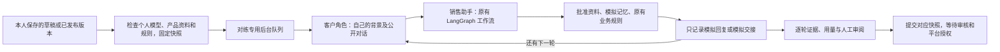

# 模拟客户对练与正式启用前验收（V1.3）

对练回答的是“这份助手配置在这个场景里会怎么做”。不启动销售任务，不向真实客户发消息。设计依据是吴姐的《自动化行销 Agent · 效果与流程蓝图》、`auto-marketing-agent-design.md` 的 Persona Bank（客户角色库）、Self-play Runner（双角色对练）和模拟评测，以及六种销售模板。

## 一次对练如何运行

选择模板、复制模板、保存草稿均不会自动发起模型请求。点击“开始模拟客户对练”才排第一轮。两侧调用同一个已选择的连接和模型。双方没有共享提示词。启用可选的模型评阅后，第三个、独立的评阅上下文也使用这个连接。

| 角色 | 可以看 | 不能看或做 |
|---|---|---|
| 虚构客户 | 产品名称、购买场景、客户自己先前的发言和收到的回复；在合适提问后允许披露的一项设定 | 不读销售方指令、知识库原文、其他客户或工具。不获知密钥；没有外部工具。 |
| 销售助手 | 冻结的角色、目标、产品和工具设置；按原收件规则检索的批准资料；这个虚构客户已说过的话 | 看不到后台保存的预算、顾虑或决策权。不能读正式客户档案或写正式工单。 |
| 评阅者 | 对练所有者可看本人的对话、逐轮依据和建议；提交之后，审核员只能看候选摘要 | 质量模型只看被评的本轮问答。不用隐藏答案替销售方写回复。审核员不能调阅他人的私有全文。 |

六种客户是普通意向、谨慎采购、预算敏感、态度冷淡、高意向和边界与异常。行业、品牌、软件、维护等模板分别推荐合适的业务身份；个人模板、空白助手也可使用。客户的需求、预算、顾虑、决策权限一次生成，单独保存。“用同一客户重练”可保留同一虚构背景，重开对话和记忆，便于比较角色调整的影响。

## 复用和隔离如何同时做到

销售方通过 `app/workflows.py` 的同一张 LangGraph 图：读取资料 → 分析 → 保存有来源的事实 → 生成或申请工具 → 检查输出 → 回复或转人工。角色提示的组装、模型适配器、知识检索和策略判断沿用正式代码。找不到相关资料时，使用正常的证据判断；不能把仅供人工确认的草稿当作销售回复继续对练。

对练给图注入单独的存储、模型调用记账和模拟送达处理。它没有真实客户、销售任务、渠道账号或发送接口。工具清单必须同时满足助手白名单、产品许可和已实现的模拟适配器；当前只有回复意图和纯内存的虚构订单查询。订单号只认演练专用值，真实渠道和网关也会拒绝对练执行对象。报价交接只写入本轮的原因、原话和规则依据。

数据库迁移 `0012_customer_practice` 新增五张表，不回写已有版本：对练及配置快照、客户隐藏设定、逐轮问答与证据、模型调用及用量、人工审阅。每张表启用企业行级隔离；工作台另外检查产品权限和当前用户是否拥有该助手和对练。快照引用本人的连接 ID，不复制密钥。私有设定、模型原始缓存和连接 ID 不通过对练接口返回。

## 推进、停机与费用

- 逐轮模式在完整来回后等待，不占用进程。自动模式每次只领取一轮，让其他对练也有执行机会。对练 Worker 单独运行，只领取 `practice` 队列。
- 默认 8 轮，允许 1～16 轮。默认用量保护为 64,000 Token，可调 1,000～150,000。每次外部模型调用前预留输入和输出空间；已知用量按供应商回报核销，没有回报时按预留量计入保护额度。它不是人民币账单。Mock 不产生模型费用。
- 每次提交带幂等键；控制命令带看到的修订号。行锁、租约和唯一的“对练／轮次／模型步骤”阻止同时领取和重复计费。暂停或结束不等待网络；已经发出的请求可能收费，返回后仅记账，不借此启动下一次调用。
- Worker 可重用已经落库的模型输出。中断时若无法确定供应商是否执行，停止并提示“结果未知”，不自动重发。关闭模型自动重试；模型错误保留此前证据。资料撤回、权限变化或助手停用也会阻止继续。
- 退订、明确拒绝、约定下一步、强制交接、硬规则问题或达到上限时停止。对没有可靠判断依据的自然语言，由人查看，不能把没有命中某个词当作安全证明。

## 如何理解验收

| 依据 | 例子 | 可以得出的结论 |
|---|---|---|
| 后端规则与轨迹 | 明确退订后没有销售方调用；正式报价触发所选规则；被拒的工具没有执行 | 针对这一轮给出事实、原话、来源。明确违反停发、权限、强制交接或明确的未批准商务承诺可否决候选。 |
| 文字观察与批准资料 | 重复同一句、连续三个问号、数值承诺和资料不符、具体参数缺少依据 | 显示轮次和原因。未经证实的技术参数先拦截待复核；关键词规则不能证明所有自然语言事实都正确。 |
| 可选模型意见 | 需求识别、沟通自然度、是否回答异议 | 每条注明模型意见；引用必须能在销售回复中找到，无法核对时交人工。不会推翻硬规则。 |
| 人工判断 | 是否符合角色、是否诚实、数据是否最新、下一步是否得体 | 记录“认可”或“需修改”和意见；旧快照只能代表旧配置。 |

结束、人工认可、提交候选、审核员推荐、正式平台授权是不同动作。本版只到“待平台授权”。审核员可退回。没有收发适配器、账号归属、官方许可、操作范围、限频停发、正式回执与紧急停用措施，不会授予执行权。模拟表现和真实成交概率没有换算关系；不使用 70% 门槛。

## 给开发人员的接口索引

以下路径前缀为 `/console/manage`，使用原有登录、工作区检查和写操作幂等键。读详情、读历史和刷新页面均不调用模型。原有业务 API 契约不变。

| 方法与路径 | 输入与返回 |
|---|---|
| GET `/agents/{aid}/practice-personas` | 返回六种客户和推荐项。 |
| POST / GET `/agents/{aid}/practices` | 创建指定草稿修订或发布版本的测试；可选客户、逐轮/自动、轮数、用量上限、费用确认、模型评阅及复用场景。POST 返回 202、模拟编号和排队状态；GET 按时间倒序分页（默认 20 条），可用 before 继续读取更早记录；比较时可只读已结束记录。 |
| GET `/practices/{id}` | 读聊天、调用过程、工具、规则、评测和人工审阅；区分已完成的回合与尚无回复的客户发言。 |
| POST `/practices/{id}/control/{action}` | next、auto、pause、resume、stop；携带 expected_revision。仅已受理的推进返回 202。 |
| POST `/practices/{id}/review`、`/practices/{id}/submit` | 所有者记录判断、备注，再提交经审阅的同一配置。无效、过期或有硬规则违规的记录不能用于提交。 |
| GET `/practice-candidates`、POST `/practice-candidates/{id}/review` | 有发布管理权限的人看候选摘要，填写推荐或退回及理由；不创建正式客户、工单、权限或任务。 |

维护者详见[开发与验收报告](../implementation/ChatMoney_模拟客户对练开发与验收报告.md)。后续如引入只读企业工具，先给它实现虚构数据适配器并补隔离测试；未列入模拟网关清单的工具继续拒绝。
