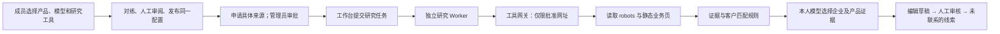

# V1.4 企业官网资料研究

这是客户建档前的只读任务。输入是一个已批准的网址，输出是可复核的证据、匹配判断和联系草稿。整个流程没有正式客户 ID、客户会话或发送工具。



**四个不同角色。** API 是网页提交和查询的入口。MCP 是连接工具的协议，本工具仅在本次研究上下文登记一个只读操作。Skill（内部业务步骤，本版以受控代码实施，没有独立下载的脚本或插件市场）版本 `company-research/1` 固定资料核对、取证、匹配、起草和等待审核的顺序，不从网站下载指令。LangGraph（工作流）和 PostgreSQL Worker（后台执行进程）负责阶段衔接、去重和恢复。正式聊天网关、模拟对练、正式只读研究使用不同执行入口。

## 授权、输入和输出

1. 在销售助手向导选择“企业官网资料研究”。保存的 `research_tools` 是申请意愿，不是许可；模板不继承网络权限。普通销售聊天不能调用这个真实入口。模拟对练的同名工具只返回标记为虚构的资料。
2. 管理员登记**精确主机和业务页／目录**、许可依据、用途、有效期、摘录保留期和是否允许记录合作页、交由外部模型处理。没有自动读取和留存许可的站点首版拒绝接入。须另外确认是否允许营销使用；工作台不能替企业出具证明。
3. 申请关联本人、企业、产品、已发布版本、经人工推荐的同一对练配置指纹、来源。管理员明确批准后才可执行。改草稿不动已发布版本；换发布版本须重新申请。来源撤回、到期、助手／成员停用、资料撤回都会阻止继续。管理员能审批，不能查看其他成员的私有研究卡或用其模型。
4. 成员提供网址、研究目标、1～7 项客户画像条件（目标词、明确排除词、权重）。后台自行确定所属企业、产品、权限和模型。最多 3 页、深度 1、6 个请求（含 robots 和重定向）、单次网站访问预算最多 22 秒；每来源每小时最多 12 项，每人最多同时 3 项。若选个人 DeepSeek，还需允许外部模型处理并确认费用。明确选 Mock 时，网络读取仍是真实的，选证与草稿演示不代表模型质量。
5. 结果保留网站明确写出的企业名称、站点署名、业务、产品、地区等；没有就留空。只允许保存获准的短摘录、来源、读取时间、响应码、字节数和产品资料引用；不留网页全文、私人邮箱、个人电话。仅在许可范围内记录官方通用联系页链接。找到联系页也只显示“联系资格未核实”。

**一次请求传什么？** 登录成员通过带幂等键的 `POST /console/manage/agents/{aid}/research/jobs` 提交。下面仅为字段示例，网址、申请和企业均不表示获得授权：

```json
{
  "grant_id": "<管理员批准的本助手授权>",
  "company_url": "https://company.example/business/",
  "research_goal": "确认官网是否有储能产品",
  "criteria": [{"field":"main_products","include":["储能柜"],"exclude":["仅供食品"],"weight":3}],
  "max_pages": 2, "max_depth": 1, "request_budget": 5, "timeout": 22,
  "accept_model_cost": false
}
```

受理返回 202，数据中含 `id`、`run_id`（本次独立研究编号）和 `status=queued`；结果从 `GET /console/manage/research-jobs/{id}` 取得，不查普通客户会话。成员不能指定企业、所有者、模型密钥或增加许可域名。`agent_id`来自路由；产品和工具意愿来自已发布版本。MCP（工具连接协议）调用只接受与获准任务完全一致的 `company_url`；活动许可范围、实际连接和预算由后台传入，不能由网页或模型重写。

工具结果是 `pages`（网址、字段／短摘录、可能的官方商务页面）和 `requests`（实际网址、响应状态、字节数）。交给工作流后，报告增加 `evidence`、`retrieved_at`、获批产品证据、`fit.score`／`fit.coverage`／逐项依据、`unknown_fields`、`draft`、`review_status` 和 `contacted=false`。联系人资格保持未核实；意向和成交概率为空。存储许可不允许留存这些字段时，不受理本版研究。

## 为什么不能让模型直接打开网址

服务器只访问获准的 HTTPS 主机与路径，保守拒绝查询串、账号密码、非标准端口、登录及商业平台入口。全部 DNS（域名解析）结果必须可公开路由。向经验证的数字 IP 发起连接，使用原域名验证 TLS 证书并核对实际对端地址；关闭环境代理、Cookie 复用和自动重定向。每跳重新检查范围、robots、解析和实际地址。拒收脚本、附件、过大响应、访问限制与不支持的编码，不更换身份或浏览器重试。

网页信息只作为用户级别的参考数据。模型仅能从现有证据和获批产品片段中选编号及邀约方式；不能提供地址、执行代码、调用其他工具或决定放行。对模型返回的编号再次验证，再用获准摘录构成可编辑的个性化草稿。私人模型密钥只到模型服务，不会进入网站请求。技术不能自动判断所有商业许可和自然语言事实，人工须核实企业主体与上下文。

## 分数怎样算

当网页只给出页面简介时，标记为“网页说明”；它不能证明企业主营业务或产品。企业自我介绍、明确标注的产品或企业结构化声明分开列出。“不要追踪链接”的站点／页面／单个链接均不向下读取。

每个维度比较对应事实和规则。命中目标或明确排除词才能记为有证据；缺失、正反冲突不算“不匹配”。匹配分 = 已匹配权重 ÷ 有明确结论的权重；证据覆盖率 = 有明确结论的权重 ÷ 配置总权重。覆盖不到一半则不出匹配分。逐条保留证据编号、原文和网址。没有客户对话，不给购买意向分；没有真实结果校准，不给成交概率，不用 70% 成交门槛。

## 接口与恢复

工作台接口统一在 `/console/manage` 下，沿用已有账号、企业隔离、写入幂等键。后台受理返回 202 和研究编号，不代表成功。读取结果和刷新页面不发起新研究。

| 操作 | 方法与路径 |
|---|---|
| 来源列表、登记、撤回 | GET / POST `/research-sources`；POST `/research-sources/{id}/revoke` |
| 查看与审批团队的工具申请 | GET `/research-grants`；POST `/research-grants/{id}/decision`（批准／拒绝／撤销） |
| 助手的权限和历史、申请、发起研究 | GET `/agents/{aid}/research`；POST 同路径的 `/grants`、`/jobs` |
| 研究详情、停止和手动重试 | GET `/research-jobs/{id}`；POST 同路径的 `/stop`、`/retry` |
| 保存修改的草稿、人工审核、保存线索 | POST 同路径的 `/review`、`/lead` |

数据库修订 `0013_company_research` 新增来源、版本工具授权、研究任务和线索指针四张表，均启用企业行级隔离。正式客户和原有助手历史不变。每个任务保存工具/流程版本、运行阶段、证据与人工决定。保留期到期后立即停止展示，后台清除内容；撤回来源同时清理相关摘录和线索。在数据库已生成的备份适用原备份保留策略，不声称在线删除能改写历史备份。

后台一次只领取一项研究，同一网站互斥。已经持久保存的摘录可以继续分析，不再重新请求网站。中断时如果无法确认外部请求或模型费用，标明失败，须人明确重试；旧记录保留。停止正在执行的研究不会撤销已发出的只读请求或账单，不再接纳迟到结果。重复点击不重复创建任务；同一成员、产品和规范化目标网址只保留一个待跟进指针，不按企业名称合并法人。

后续如接搜索，仅登记“发现官网”的能力、费用、范围和留存策略；已有研究授权不自动扩展。敏感读取（如订单）、外部写入和支付等高风险动作不属于本版。没有营销发送、提交询盘、订单修改或账号登录通道。
